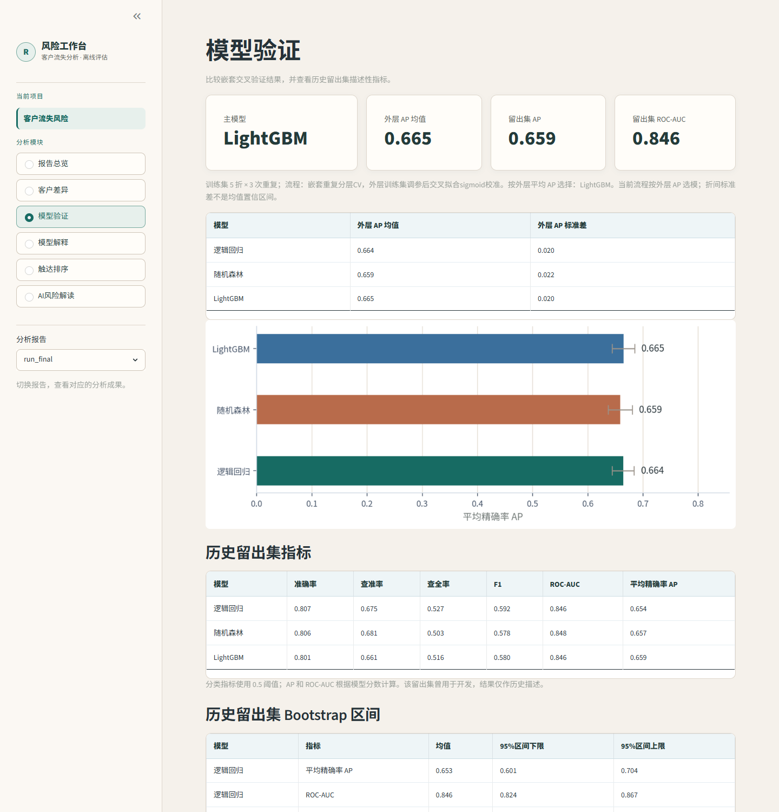
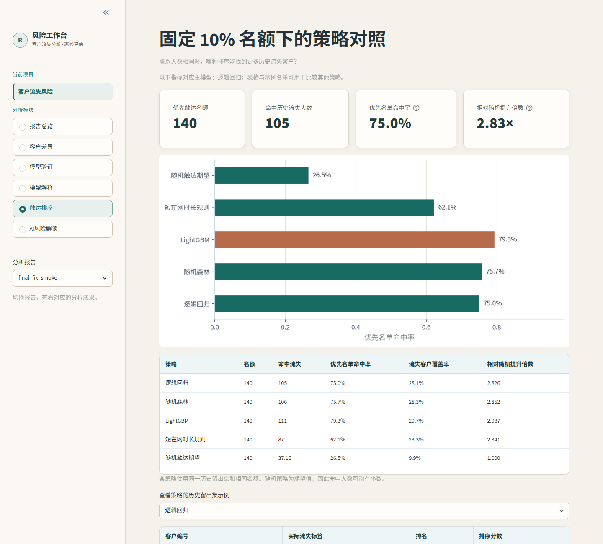
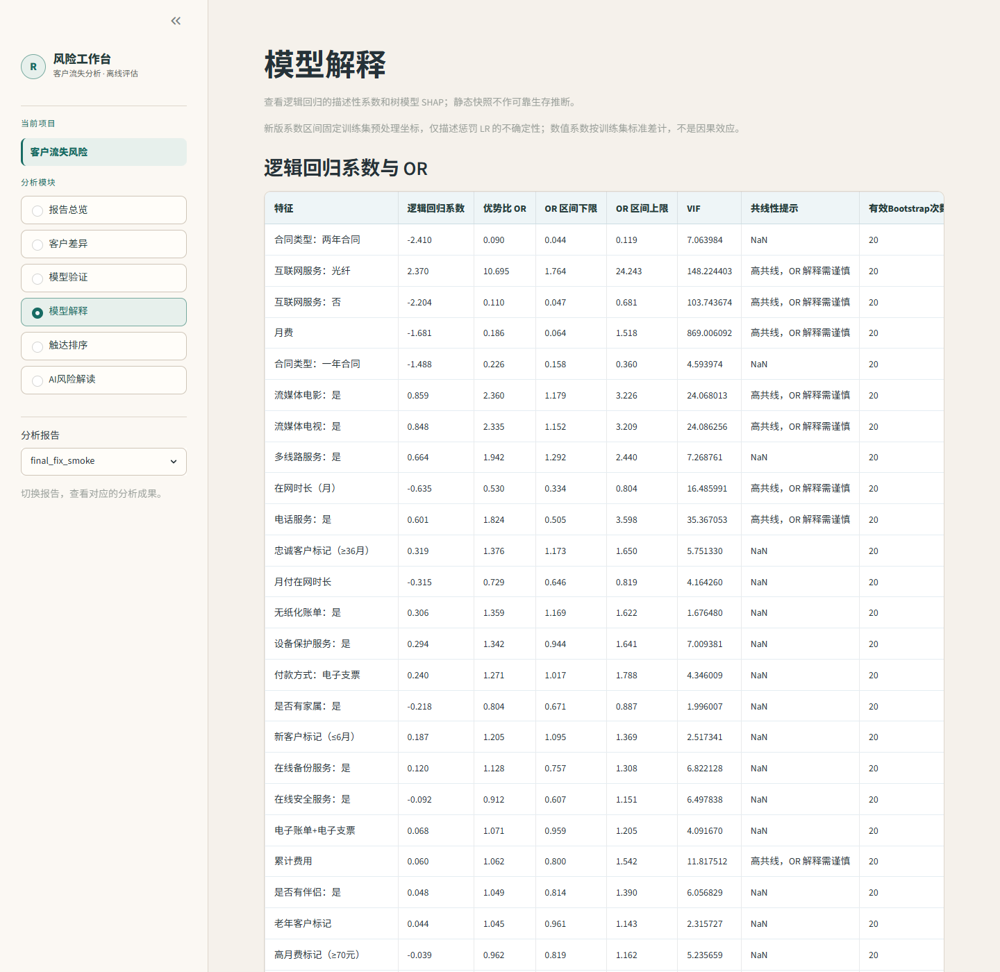
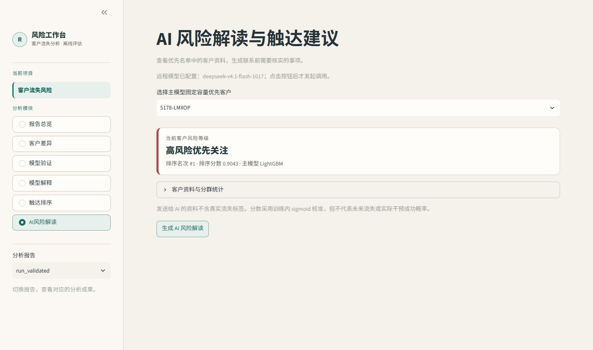

<div align="center">

# Telco Churn Ranking

基于 7,043 条公开电信客户数据的流失风险排序实验：外呼名额有限时，先打给谁？

[](requirements.txt)
[](requirements.txt)
[](requirements.txt)
[](requirements.txt)
[](dashboard.py)
[](tests/test_project.py)

[结果速览](#结果速览) · [快速运行](#快速运行) · [看板页面](#看板页面) · [验证流程](#验证流程) · [实验细节](#实验细节) · [目录结构](#目录结构) · [局限说明](#局限说明)

</div>

---

客服团队每天能拨出的挽留电话有限，拿 0.5 当阈值切一刀二分类，解决不了排期先后问题。这个仓库把目标放在 Top-K 排序上：给定 10% 的联系容量，比较逻辑回归、随机森林、LightGBM 和业务经验规则谁能圈出更多高危客户。

代码覆盖了 SQL 分群检验、5×3 嵌套交叉验证、特征消融、概率校准对照和 Streamlit 看板。为了防止数据泄漏把指标做虚，调参、阈值选择和预算测算全部限制在训练集折外预测（OOF）里，锁定之后才去跑测试集。


## 结果速览

内置完整报告 [`outputs/run_validated`](outputs/run_validated/metrics.json)（随机种子 `42`，训练集 5,634 人 / 测试集 1,409 人，测试集流失率 26.54%）的主要数据：

- 主模型按嵌套 CV 外层平均 AP 选出 LightGBM（外层 `0.6652 ± 0.0192`，测试集 AP `0.6695`，ROC-AUC `0.8482`）。做完 Nadeau–Bengio 相关折方差修正和 Holm 校正后，三个模型的差异均未达到统计显著（$p > 0.62$），正则化逻辑回归在这份表格数据上其实很能打。
- 测试集取前 10% 名额（140 人），LightGBM 圈中 109 名历史流失客户，Precision@140 为 `77.86%`，是随机抽样期望（37.16 人）的 `2.93` 倍，比“优先联系短在网客户”的经验规则多找回 22 人。
- 同折逻辑回归消融里，单独加费用类或服务类衍生特征都没涨分，全部拼在一起外层 AP 均值只比原始特征高 `0.0031`。
- 训练折内做 sigmoid 校准只让逻辑回归的测试 Brier 略微下降（`0.1365 → 0.1363`），随机森林和 LightGBM 反而变差（LightGBM `0.1341 → 0.1354`）。报告里保留了校准前后的双轨记录，没有看着测试集回头改流程。

> [!NOTE]
> 这里的“命中”指测试集历史标签为流失，用来衡量离线名单浓度，不代表电话打过去一定能挽留成功。

## 快速运行

仓库自带跑好的 `outputs/run_validated/` 报告产物，不用下原始 CSV 也不用配数据库，装好依赖就能直接看看板：

```bash
python -m pip install -r requirements.txt
python -m streamlit run dashboard.py -- --output outputs/run_validated
```

<details>
<summary>从头重跑训练、配置 MySQL / AI 接口与运行测试</summary>

<br>

**重新训练**

去 [Kaggle Telco Customer Churn](https://www.kaggle.com/datasets/blastchar/telco-customer-churn) 下载 `WA_Fn-UseC_-Telco-Customer-Churn.csv` 放进 `data/`。输出路径必须指定新目录，程序遇到非空目录会直接报错退出，避免误删旧报告：

```bash
# 完整配置（SQLite 内存分群，5×3 嵌套 CV，LightGBM 每折 30 轮 Optuna，1000 次 Bootstrap）
python run_project.py --output outputs/run_new

# 低预算冒烟检查（只验代码通路，别拿它的数字当实验结论）
python run_project.py --output outputs/smoke_check --outer-splits 3 --repeats 1 --inner-splits 2 --trials 1 --bootstrap 20 --no-explanations
```

**可选外部服务**

默认用内置 SQLite 跑完 [`sql/segment_analysis.sql`](sql/segment_analysis.sql)。想验证 MySQL 8.0+ 路径的话，把 `.env.example` 复制成 `.env` 填好连接参数，加上 `--backend mysql` 即可；脚本只建会话临时表，不改动库里原有表。

看板里的 AI 解读页默认走本地模板。配好 `CHURN_AI_BASE_URL`、`CHURN_AI_MODEL` 和 `CHURN_AI_API_KEY` 后，点页面上的生成按钮才会发请求。发送内容做过白名单裁剪，不含真实流失标签，AI 也不介入打分和名单排序。PyCharm 配置与部署细节见 [`docs/RUNNING.md`](docs/RUNNING.md)。

**跑测试**

```bash
python -m pytest -q
```

共 47 项测试，测了脏数据拦截、外层验证防泄漏、翻转测试集标签不改变模型与阈值选择、SQLite/MySQL 分群结果对齐，以及 18 个看板页面的无头渲染。

</details>

## 看板页面

看板侧栏可以切换不同批次的实验报告。除了最上面的总览页，另外五个分页内容如下：

<table>
  <tr>
    <td width="100%" valign="top">
      
      <p align="center"><b>客户差异</b><br>训练集上的合同、在网时长与月费分群，附带 Wilson 区间、卡方检验 Holm 校正和 Cramér's V，避免把小样本波动当规律。</p>
    </td>
  </tr>
  <tr>
    <td width="100%" valign="top">
      
      <p align="center"><b>模型验证</b><br>并排查看嵌套 CV 外层分布与固定测试集得分，包含模型配对检验、四组特征消融、校准曲线和 PR 曲线。</p>
    </td>
  </tr>
  <tr>
    <td width="100%" valign="top">
      
      <p align="center"><b>触达排序</b><br>对比 10% 固定容量下的各策略命中人数与 Lift，另单独列出训练 OOF 选出的冻结名额和 27 组成本收益假设。</p>
    </td>
  </tr>
  <tr>
    <td width="100%" valign="top">
      
      <p align="center"><b>模型解释</b><br>查看惩罚逻辑回归的标准化系数与 Bootstrap 描述区间，以及未校准树基模型的 SHAP 汇总与单样本瀑布图。</p>
    </td>
  </tr>
</table>

<details>
<summary>展开查看：AI 风险解读页</summary>

<br>



把入选客户的合同信息、费用情况、当前分数和训练集同类人群统计摆在一起，方便外呼前快速核对客户背景。

</details>

## 验证流程

表格数据项目最容易在不知不觉中漏数据：比如先在全表算均值填缺失再切分，或者对着测试集调分类阈值。下面这张图是代码里实际跑的隔离顺序：


读入 CSV 做完主键去重和字段检查后，先分层留出 20% 测试集。后面的 SQL 分群、相关系数计算全部只喂 80% 训练集；缺失填补、标准化和独热编码放进 `ColumnTransformer`，跟着每个训练折重跑。

模型评估用 5 折 × 3 次重复的外层划分，LR、RF、LightGBM 在各自 3 折内层里搜超参数并拟合 sigmoid 校准。外层平均 AP 决定主模型，按客户聚合的训练 OOF 预测决定 F1 阈值和业务情景名额。所有参数定死后，最后进一次测试集出报告。

## 实验细节

### 模型指标与配对检验

| 模型 | 外层 AP（均值 ± 折间 SD） | 测试集 AP | 测试集 ROC-AUC | 训练 OOF 阈值 | 测试集 F1 |
|:---|---:|---:|---:|---:|---:|
| LightGBM | 0.6652 ± 0.0192 | 0.6695 | 0.8482 | 0.3085 | 0.6399 |
| 逻辑回归 | 0.6636 ± 0.0188 | 0.6498 | 0.8453 | 0.3383 | 0.6068 |
| 随机森林 | 0.6601 ± 0.0211 | 0.6578 | 0.8464 | 0.3250 | 0.6248 |

表里的标准差是 15 个外层折之间的波动，不是均值置信区间。因为交叉验证折与折之间共享训练样本，普通配对 $t$ 检验会低估标准误，这里用了 Nadeau–Bengio 方差修正加 Holm 校正：LR–RF（$p=0.799$）、LR–LightGBM（$p=0.799$）、RF–LightGBM（$p=0.623$）都没有显著差异。分类阈值按训练 OOF 最大 F1 选取，Top-K 排序本身不依赖这个阈值。

### 10% 容量排序与情景测算

测试集 1,409 人的 10% 向下取整为 140 人，同分时按 `customerID` 升序排列：

| 排序方式 | 命中历史流失人数 | Precision@140 | Recall@140 | Lift@140 |
|:---|---:|---:|---:|---:|
| LightGBM | 109 | 77.86% | 29.14% | 2.93 |
| 随机森林 | 107 | 76.43% | 28.61% | 2.88 |
| 逻辑回归 | 105 | 75.00% | 28.07% | 2.83 |
| 短在网时长规则 | 87 | 62.14% | 23.26% | 2.34 |
| 随机选择期望 | 37.16 | 26.54% | 9.94% | 1.00 |

如果给外呼加上成本收益假设（基准设为触达成本 50 元/人、挽留成功多留存 12 个月、成功率 30%，用客户自己的 `MonthlyCharges` 近似月收入），训练 OOF 算出的最优联系比例是 50%，冻结到测试集上的账面情景净收益约 52,678 元。3 档成本 × 3 档成功率 × 3 档留存月数组合出的 27 组结果（含不联系与全联系）存在 [`business_scenarios.csv`](outputs/run_validated/business_scenarios.csv) 中。月费不等于毛利或真实 CLV，这组数字只作敏感性参考。

### 特征消融与概率校准


固定逻辑回归家族、共享同一组外层折做四组对比（每组独立内层调参）：原始特征外层 AP 均值为 `0.6604`，原始+费用类为 `0.6586`，原始+服务类为 `0.6601`，全部衍生特征合在一起为 `0.6636`（逐折明细见 [`ablation_folds.csv`](outputs/run_validated/ablation_folds.csv)）。

上图右表是校准前后的测试集 Brier 分数（越低越好）：逻辑回归 `0.1365 → 0.1363`，随机森林 `0.1348 → 0.1359`，LightGBM `0.1341 → 0.1354`。在小几千行的训练集上拆折拟合 sigmoid，并不能保证改善树模型的概率校准度。

## 目录结构

```text
telco-churn-ranking/
├── run_project.py                  # 训练命令行入口
├── dashboard.py                    # Streamlit 看板入口
├── telco_churn/
│   ├── pipeline.py                 # 数据检查、特征构造与主流程
│   ├── validation.py               # 嵌套 CV、调参、校准与特征消融
│   ├── statistical_inference.py    # Bootstrap、Nadeau-Bengio 修正与 Holm 校正
│   ├── budget_analysis.py          # OOF 名额选择与业务情景表
│   ├── mysql_segments.py           # SQLite / MySQL 训练集分群
│   ├── model_explanation.py        # 逻辑回归系数重采样与树模型 SHAP
│   ├── reporting.py                # 诊断图绘制与运行环境记录
│   └── test_revision.py            # 防泄漏与统计计算回归测试
├── sql/segment_analysis.sql        # 分群汇总、交叉表与窗口排名查询
├── optional_ai/assistant.py        # 客户资料解读模板与可选接口调用
├── tests/test_project.py           # 端到端流程与看板 AppTest 测试
├── outputs/run_validated/          # 完整运行报告
└── docs/                           # 流程图、截图、运行文档与面试核对提纲
```

<details>
<summary>outputs/run_validated/ 报告文件清单</summary>

<br>

| 文件 | 内容 |
|:---|:---|
| `metrics.json` | 运行配置、主模型、测试指标、配对检验、数据 SHA256 与依赖版本 |
| `nested_cv_folds.csv` / `training_oof.csv` | 15 个外层折得分明细与客户级训练 OOF 分数 |
| `ablation_folds.csv` / `ablation_summary.csv` | 逻辑回归四组特征消融逐折得分与汇总 |
| `calibration_comparison.csv` / `calibration_pr.png` | 校准前后指标对照及校准 + PR 组合图 |
| `segment_summary.csv` / `segment_inference.csv` | 训练集分群统计、Wilson 区间与关联检验 |
| `policy_metrics.csv` / `policy_assignments.csv` | 10% 容量策略对比表与测试集排序名单 |
| `budget_training_oof.csv` / `business_scenarios.csv` | 训练 OOF 名额曲线与 27 组业务情景 |
| `logistic_coefficients.csv` / `shap_summary.png` | 逻辑回归系数区间表与树模型 SHAP 图 |

字段说明见 [`docs/RUNNING.md`](docs/RUNNING.md#报告文件)，测试与验收记录见 [`telco_churn/IMPLEMENTATION_STATUS.md`](telco_churn/IMPLEMENTATION_STATUS.md)。

</details>

## 局限说明

这份公开数据是单次静态截面，没有客户的入网日期、流失发生时刻和历史外呼记录，做不了时间外滚动验证，也没法评估干预前后的真实因果增量（Uplift）。出于同样原因，由于缺少清晰的入组与删失机制，主流程默认关掉了早期探索过的生存分析模块。

方法层面上还有三处边界：一是校准器直接复用了当前训练子集选出的超参数做折内拟合，没再套第三层 CV，所以看校准好坏必须以隔离的外层或测试集 Brier 为准；二是逻辑回归的 OR 区间是在固定预处理坐标和正则化下重采样算出来的，只反映估计波动，不能当因果效应解释，SHAP 图也只对应校准前的树基模型；三是 Kaggle 这份公开表在开发阶段反复看过，哪怕本次实验严格锁死了测试集，它也不算真正意义上的一次性盲测数据。

## 参考与数据来源

- 数据集：[Kaggle — Telco Customer Churn](https://www.kaggle.com/datasets/blastchar/telco-customer-churn)（源自 [IBM Sample Data Sets](https://github.com/IBM/telco-customer-churn-on-icp4d)）
- 依赖库：[scikit-learn](https://scikit-learn.org/stable/) · [LightGBM](https://lightgbm.readthedocs.io/) · [Optuna](https://optuna.readthedocs.io/) · [SHAP](https://shap.readthedocs.io/) · [Streamlit](https://streamlit.io/)
- 方差修正方法：Nadeau & Bengio (2003), *Inference for the Generalization Error*
