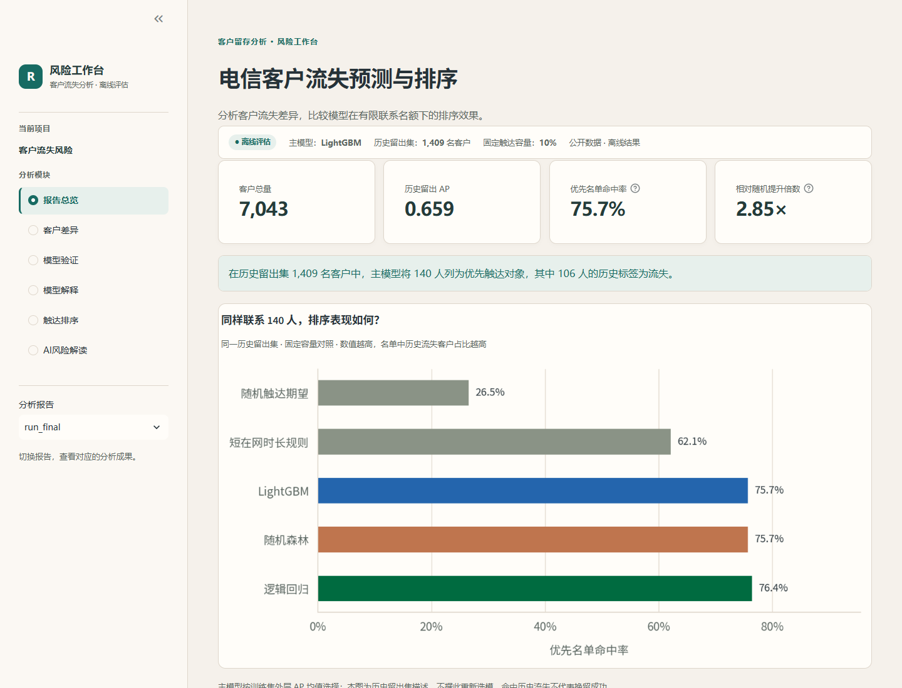
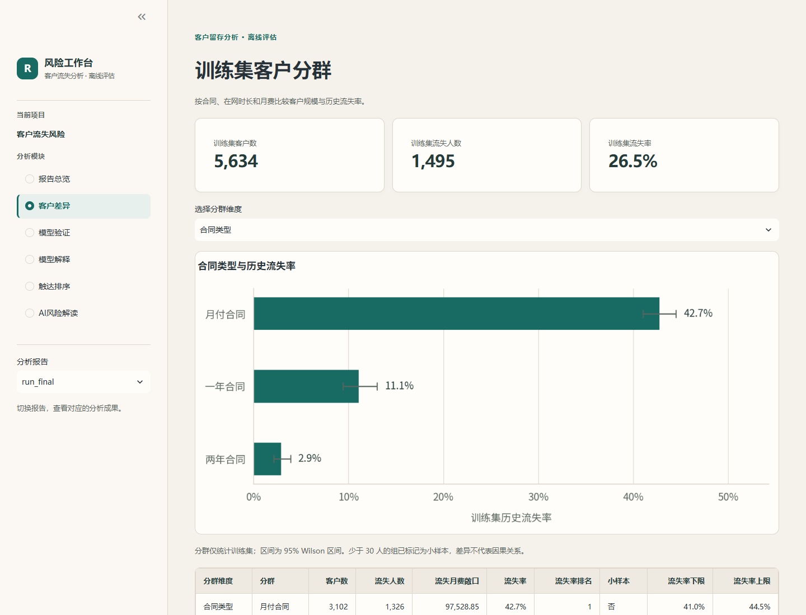
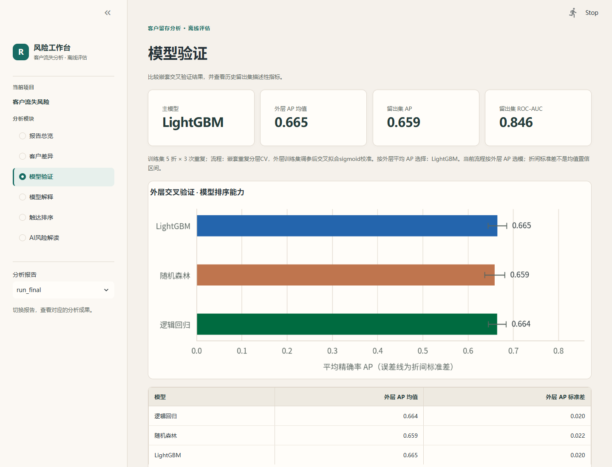
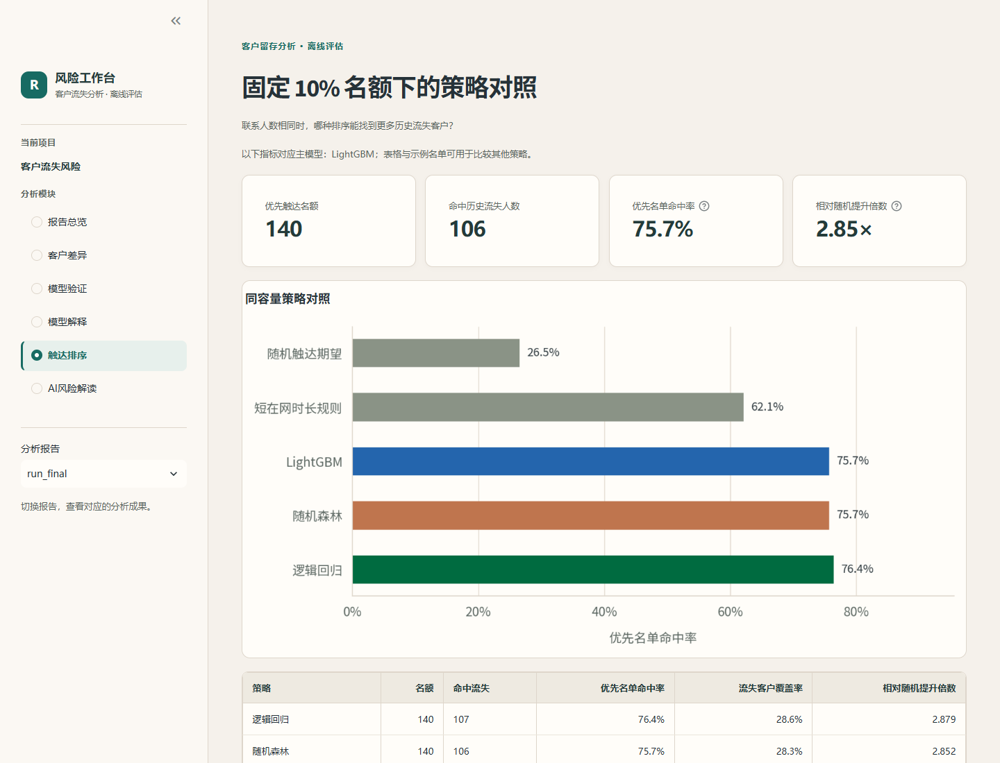
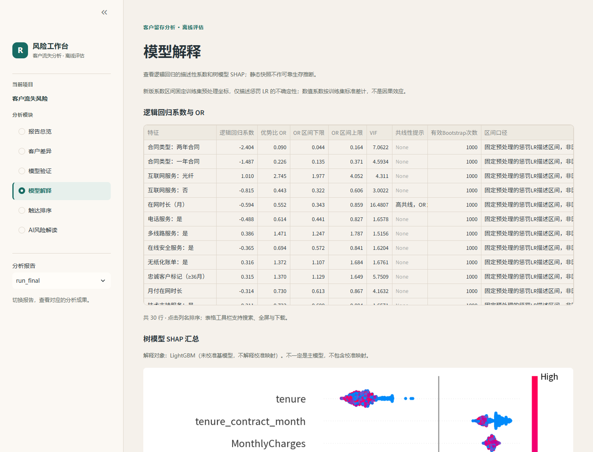
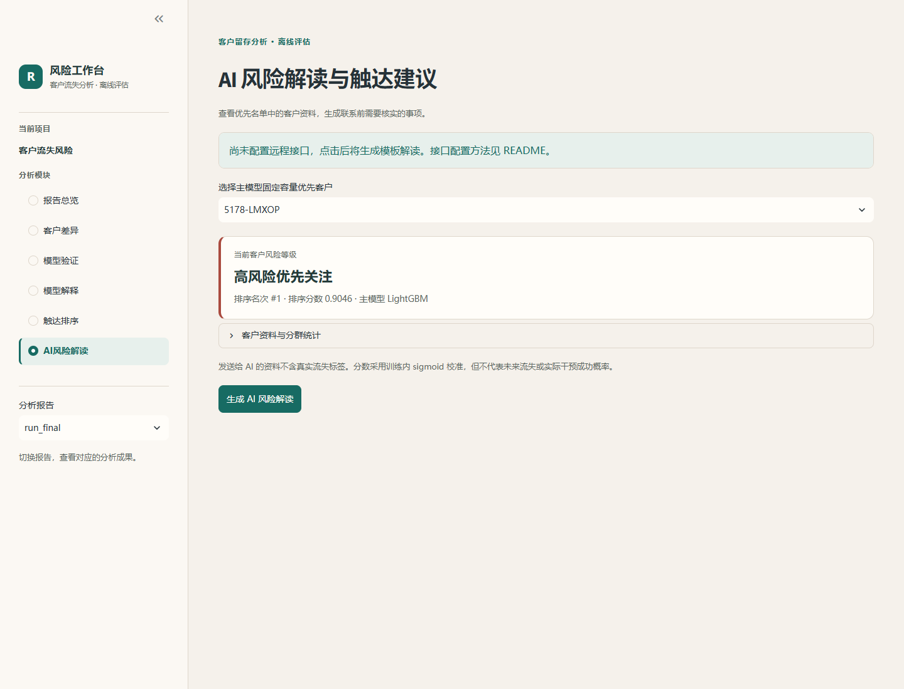
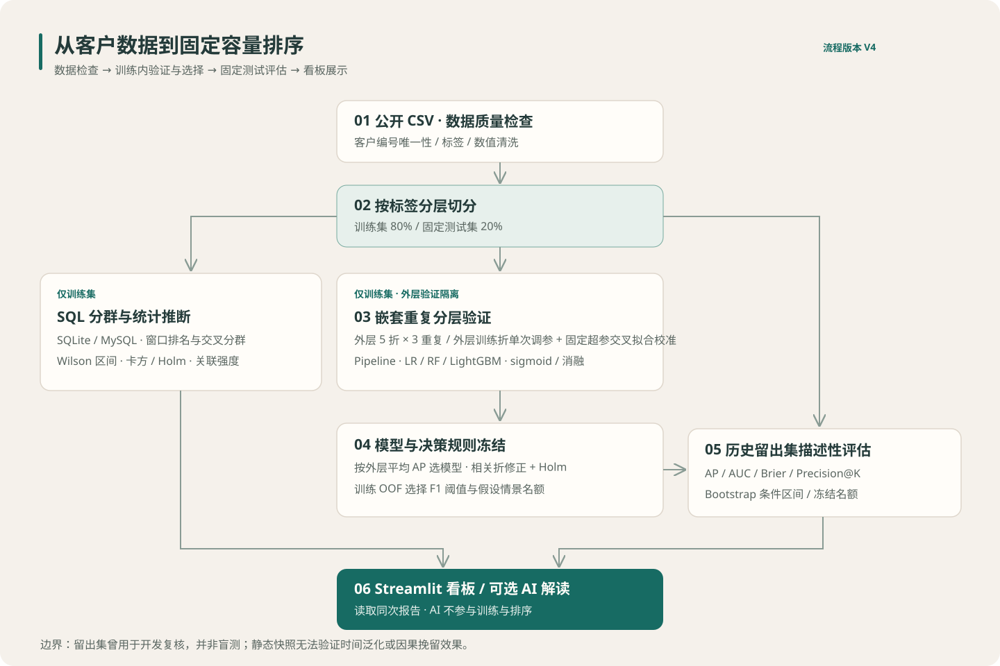
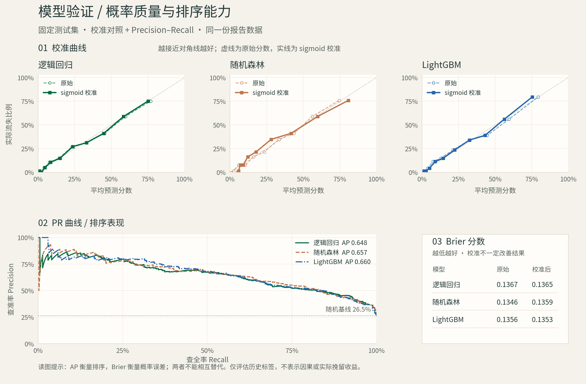

<div align="center">

# Telco Churn Ranking

基于 7,043 条公开电信客户数据的流失风险排序实验：外呼名额有限时，先打给谁？

[](requirements.txt)
[](requirements.txt)
[](requirements.txt)
[](requirements.txt)
[](dashboard.py)
[](tests/test_project.py)

[结果速览](#结果速览) · [快速运行](#快速运行) · [看板页面](#看板页面) · [验证流程](#验证流程) · [实验细节](#实验细节) · [目录结构](#目录结构) · [局限说明](#局限说明)

</div>

---

客服团队每天能拨出的挽留电话有限，拿 0.5 当阈值切一刀二分类，解决不了排期先后问题。这个仓库把目标放在 Top-K 排序上：给定 10% 的联系容量，比较逻辑回归、随机森林、LightGBM 和业务经验规则谁能圈出更多高危客户。

代码覆盖 SQL 分群检验、嵌套交叉验证、特征消融、概率校准对照和 Streamlit 看板。每个外层训练折只搜索一次基模型参数，再用固定模型交叉拟合 sigmoid 校准；阈值和预算情景只由训练集折外预测确定。



界面延续暖白与青绿风格，支持手机指标重排、长表排序和搜索。[UI 审计、设计与实施交接](docs/handoff/UI_AUDIT_AND_IMPLEMENTATION.md) · [优化前总览](docs/ui-before/overview.png) · [手机预览](docs/ui-after/demo-mobile.png)。

## 结果速览

当前唯一权威报告位于 [`outputs/run_final`](outputs/run_final/metrics.json)（随机种子 `42`，5 折 × 3 次重复、内层 3 折、每折 30 次 Optuna trial、1000 次 Bootstrap）。

- 完整运行的外层 AP 均值为：逻辑回归 `0.6640 ± 0.0198`、随机森林 `0.6587 ± 0.0221`、LightGBM `0.6645 ± 0.0204`，因此按外层均值选择 LightGBM。
- 历史留出集按前 10% 名额（140 人）排序时，LightGBM 命中 106 名历史流失客户，Precision@140 为 `75.71%`，Lift 为 `2.85`。命中数是离线排序结果，不代表实际挽留成功。
- 校准是否用于最终推理由每个模型的外层 Brier 对照决定；该次运行逻辑回归使用原始模型，随机森林和 LightGBM 使用 sigmoid 校准模型。校准不保证在每次留出集上改善。
- 风险排序与期望价值排序分别生成预算曲线；完整运行的价值排序选择 `45%` 名额，冻结情景净收益为 `53,399.68` 元，仅表示当前假设结果。

> [!NOTE]
> 这里的“命中”指历史留出样本的标签为流失。该留出集曾用于开发复核，并非独立盲测；区间条件于已拟合模型，不包含训练和选模不确定性。

## 快速运行

若当前工作区已有受控验证产物，可直接看看板；完整实验需先按下方命令重新训练：

```bash
python -m pip install -r requirements.txt
python -m streamlit run dashboard.py -- --output outputs/run_final
```

<details>
<summary>从头重跑训练、配置 MySQL / AI 接口与运行测试</summary>

<br>

**重新训练**

去 [Kaggle Telco Customer Churn](https://www.kaggle.com/datasets/blastchar/telco-customer-churn) 下载 `WA_Fn-UseC_-Telco-Customer-Churn.csv` 放进 `data/`。输出路径必须指定新目录，程序遇到非空目录会直接报错退出，避免误删旧报告：

```bash
# 完整配置（SQLite 内存分群，5×3 嵌套 CV，LightGBM 每折 30 轮 Optuna，1000 次 Bootstrap）
python run_project.py --output outputs/run_new

# 低预算冒烟检查（只验代码通路，别拿它的数字当实验结论）
python run_project.py --output outputs/smoke_check --outer-splits 3 --repeats 1 --inner-splits 2 --trials 1 --bootstrap 20 --no-explanations
```

**可选外部服务**

默认用内置 SQLite 跑完 [`sql/segment_analysis.sql`](sql/segment_analysis.sql)。想验证 MySQL 8.0+ 路径的话，把 `.env.example` 复制成 `.env` 填好连接参数，加上 `--backend mysql` 即可；脚本只建会话临时表，不改动库里原有表。

看板里的 AI 解读页默认走本地模板。配好 `CHURN_AI_BASE_URL`、`CHURN_AI_MODEL` 和 `CHURN_AI_API_KEY` 后，点页面上的生成按钮才会发请求。发送内容做过白名单裁剪，不含真实流失标签，AI 也不介入打分和名单排序。PyCharm 配置与部署细节见 [`docs/RUNNING.md`](docs/RUNNING.md)。

**跑测试**

```bash
python -m pip install -r requirements-dev.txt
python -m pytest -q
```

共 54 项测试，覆盖脏数据拦截、外层验证隔离、单次调参与交叉拟合校准、固定名额 Bootstrap 区间、测试标签翻转不改变选择、SQLite/MySQL 分群对齐、帕累托月费敞口及看板无头渲染。

</details>

## 看板页面

看板侧栏可以切换不同批次的实验报告。除了最上面的总览页，另外五个分页内容如下：

<table>
  <tr>
    <td width="100%" valign="top">
      
      <p align="center"><b>客户差异</b><br>训练集上的合同、在网时长与月费分群，附带 Wilson 区间、卡方检验 Holm 校正和 Cramér's V，避免把小样本波动当规律。</p>
    </td>
  </tr>
  <tr>
    <td width="100%" valign="top">
      
      <p align="center"><b>模型验证</b><br>查看嵌套 CV 外层分布与历史留出集指标，包含模型配对检验、四组特征消融、校准曲线和 PR 曲线。</p>
    </td>
  </tr>
  <tr>
    <td width="100%" valign="top">
      
      <p align="center"><b>触达排序</b><br>对比 10% 固定容量下的各策略命中人数与 Lift，另单独列出训练 OOF 选出的冻结名额和 27 组成本收益假设。</p>
    </td>
  </tr>
  <tr>
    <td width="100%" valign="top">
      
      <p align="center"><b>模型解释</b><br>查看惩罚逻辑回归的标准化系数与 Bootstrap 描述区间，以及未校准树基模型的 SHAP 汇总与单样本瀑布图。</p>
    </td>
  </tr>
</table>

<details>
<summary>展开查看：AI 风险解读页</summary>

<br>



把入选客户的合同信息、费用情况、当前分数和训练集同类人群统计摆在一起，方便外呼前快速核对客户背景。

</details>

## 验证流程

表格数据项目最容易在不知不觉中漏数据：比如先在全表算均值填缺失再切分，或者对着测试集调分类阈值。下面这张图是代码里实际跑的隔离顺序：



读入 CSV 做完主键去重和字段检查后，先分层留出 20% 样本。后面的 SQL 分群、相关系数计算只使用训练集；缺失填补、标准化和独热编码放进 `ColumnTransformer`，跟着每个训练折重跑。该留出集在开发期间曾被查看，不能视作独立盲测。

模型评估用外层分层交叉验证。每个外层训练子集先调参一次，再在固定超参下做交叉拟合 sigmoid 校准。外层平均 AP 用于比较模型；每个模型根据外层 Brier 决定最终推理使用原始模型或校准模型。客户级训练 OOF 预测使用同一尺度的有效概率，用于确定 F1 阈值和风险/价值两套业务情景名额；历史留出集只作描述性评估。

## 实验细节

### 模型指标与配对检验

| 模型 | 外层 AP（均值 ± 折间 SD） | 留出集 AP | 留出集 ROC-AUC | 训练 OOF 阈值 | 留出集 F1 |
|:---|---:|---:|---:|---:|---:|
| LightGBM | 0.6645 ± 0.0204 | 0.6589 | 0.8462 | 0.3184 | 0.6293 |
| 逻辑回归 | 0.6640 ± 0.0198 | 0.6538 | 0.8463 | 0.3330 | 0.6204 |
| 随机森林 | 0.6587 ± 0.0221 | 0.6571 | 0.8479 | 0.3499 | 0.6321 |

表里的标准差是 15 个外层折之间的波动，不是均值置信区间。因为交叉验证折与折之间共享训练样本，普通配对 $t$ 检验会低估标准误，这里用了 Nadeau–Bengio 方差修正加 Holm 校正：LR–RF（$p=0.630$）、LR–LightGBM（$p=0.929$）、RF–LightGBM（$p=0.630$）都没有显著差异。分类阈值按训练 OOF 最大 F1 选取，表中 F1 使用该阈值；Top-K 排序本身不依赖这个阈值。

### 10% 容量排序与情景测算

历史留出集 1,409 人的 10% 向下取整为 140 人，同分时按 `customerID` 升序排列：

| 排序方式 | 命中历史流失人数 | Precision@140 | Recall@140 | Lift@140 |
|:---|---:|---:|---:|---:|
| LightGBM | 106 | 75.71% | 28.34% | 2.85 |
| 随机森林 | 106 | 75.71% | 28.34% | 2.85 |
| 逻辑回归 | 107 | 76.43% | 28.61% | 2.88 |
| 短在网时长规则 | 87 | 62.14% | 23.26% | 2.34 |
| 随机选择期望 | 37.16 | 26.54% | 9.94% | 1.00 |

LightGBM 的 Precision@140 为 `75.71%`。区间按客户重采样并保持固定名额；它条件于已拟合模型，不包含训练、调参或模型选择带来的不确定性。

如果给外呼加上成本收益假设（基准设为触达成本 50 元/人、挽留成功多留存 12 个月、成功率 30%，用客户自己的 `MonthlyCharges` 近似月收入），代码会分别按风险分数和 `概率 × 月费` 价值代理选择名额，并在 `business_scenarios.csv` 中保留两套结果。月费不等于毛利或真实 CLV，这组数字只作敏感性参考。

### 特征消融与概率校准



固定逻辑回归家族、共享同一组外层折做四组对比；`ablation_summary.csv` 同时记录相对原始特征的配对差值区间和 Holm 校正 p 值（逐折明细见 [`ablation_folds.csv`](outputs/run_final/ablation_folds.csv)）。

上图右表是校准前后的历史留出集 Brier 分数（越低越好）。最终是否使用校准模型以外层 Brier 决策，而不是根据这一个留出集反向选模；sigmoid 也不保证改善概率质量。

## 目录结构

```text
telco-churn-ranking/
├── run_project.py                  # 训练命令行入口
├── dashboard.py                    # Streamlit 看板入口
├── telco_churn/
│   ├── pipeline.py                 # 数据检查、特征构造与主流程
│   ├── validation.py               # 嵌套 CV、调参、校准与特征消融
│   ├── statistical_inference.py    # Bootstrap、Nadeau-Bengio 修正与 Holm 校正
│   ├── budget_analysis.py          # OOF 名额选择与业务情景表
│   ├── mysql_segments.py           # SQLite / MySQL 训练集分群
│   ├── model_explanation.py        # 逻辑回归系数重采样与树模型 SHAP
│   ├── reporting.py                # 诊断图绘制与运行环境记录
│   └── test_revision.py            # 防泄漏与统计计算回归测试
├── sql/segment_analysis.sql        # 分群汇总、交叉表与窗口排名查询
├── optional_ai/assistant.py        # 客户资料解读模板与可选接口调用
├── tests/test_project.py           # 端到端流程与看板 AppTest 测试
├── outputs/run_final/             # 唯一完整预算权威报告
└── docs/                           # 流程图、截图、运行文档与面试核对提纲
```

<details>
<summary>outputs/run_final/ 报告文件清单</summary>

<br>

| 文件 | 内容 |
|:---|:---|
| `metrics.json` | 运行配置、主模型、测试指标、配对检验、数据 SHA256 与依赖版本 |
| `nested_cv_folds.csv` / `training_oof.csv` | 15 个外层折得分明细与客户级训练 OOF 分数 |
| `ablation_folds.csv` / `ablation_summary.csv` | 逻辑回归四组特征消融逐折得分与汇总 |
| `calibration_comparison.csv` / `calibration_pr.png` | 校准前后指标对照及校准 + PR 组合图 |
| `segment_summary.csv` / `segment_inference.csv` | 训练集分群统计、Wilson 区间与关联检验 |
| `policy_metrics.csv` / `policy_assignments.csv` | 10% 容量策略对照与历史留出集排序名单 |
| `budget_training_oof.csv` / `budget_training_oof_value.csv` / `business_scenarios.csv` | 训练 OOF 风险排序、期望价值排序与 27 组业务情景 |
| `budget_sensitivity.csv` / `budget_sensitivity_value.csv` / `budget_curve*.png` | 风险排序与价值排序的名额敏感性及冻结评估 |
| `segment_pareto.csv` | 按流失月费敞口累计的帕累托分群 |
| `logistic_coefficients.csv` / `shap_summary.png` | 逻辑回归系数区间表与树模型 SHAP 图 |

字段说明见 [`docs/RUNNING.md`](docs/RUNNING.md#报告文件)。

</details>

## 局限说明

这份公开数据是单次静态截面，没有客户入网日期、流失发生时刻或历史外呼记录，无法做时间外验证或估计真实干预增量（Uplift）。也缺少可靠的入组、事件和删失定义，因此主流程继续禁用生存分析。

每个外层训练折先调参一次，再在固定超参下做交叉拟合校准；外层折用于评估完整流程，但主模型也是根据这批外层结果选出的，赢家的外层均值仍可能受模型选择影响。Bootstrap 区间条件于已拟合模型，不能替代训练和选模不确定性；逻辑回归 OR 区间只描述固定预处理与正则化下的估计波动，SHAP 解释的是校准前树模型。Kaggle 留出样本曾在开发阶段反复查看，不能称为独立盲测；真正的时间泛化和因果挽留效果需要额外的纵向数据或随机干预数据。

## 参考与数据来源

- 数据集：[Kaggle — Telco Customer Churn](https://www.kaggle.com/datasets/blastchar/telco-customer-churn)（源自 [IBM Sample Data Sets](https://github.com/IBM/telco-customer-churn-on-icp4d)）
- 依赖库：[scikit-learn](https://scikit-learn.org/stable/) · [LightGBM](https://lightgbm.readthedocs.io/) · [Optuna](https://optuna.readthedocs.io/) · [SHAP](https://shap.readthedocs.io/) · [Streamlit](https://streamlit.io/)
- 方差修正方法：Nadeau & Bengio (2003), *Inference for the Generalization Error*
