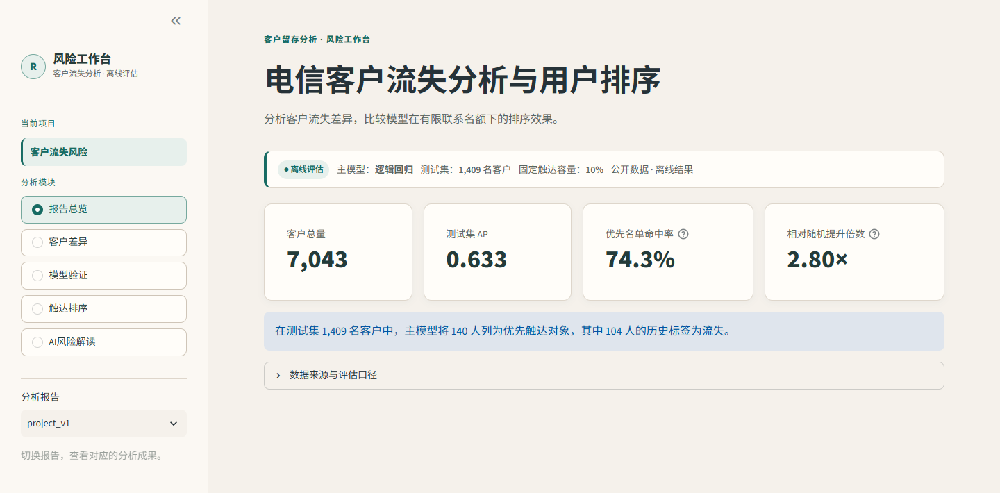
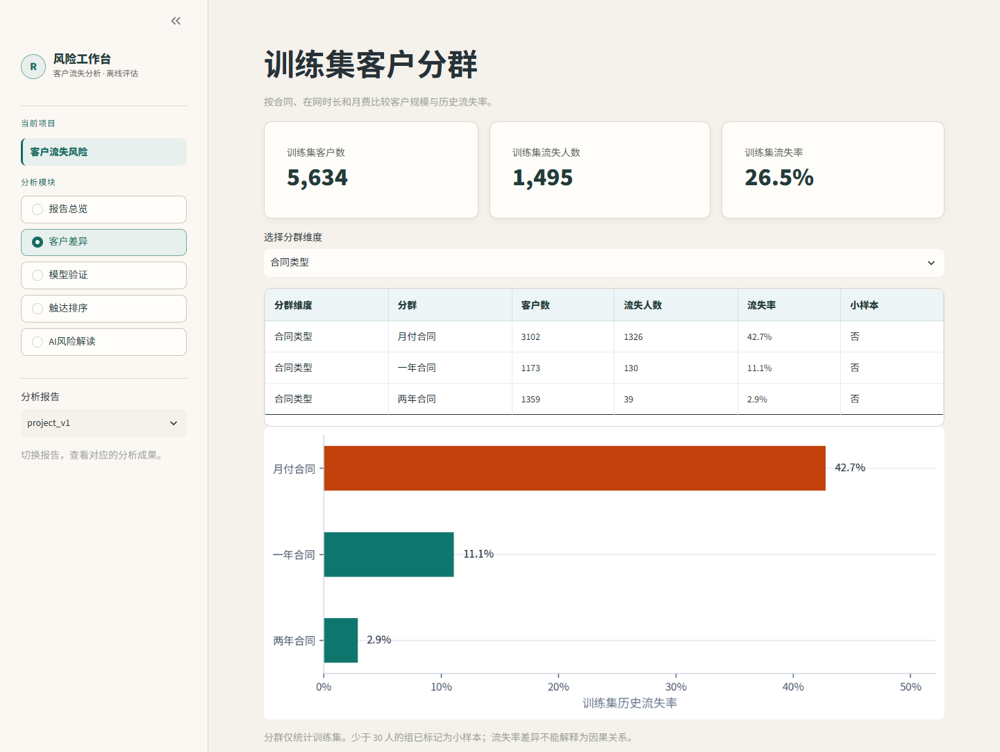
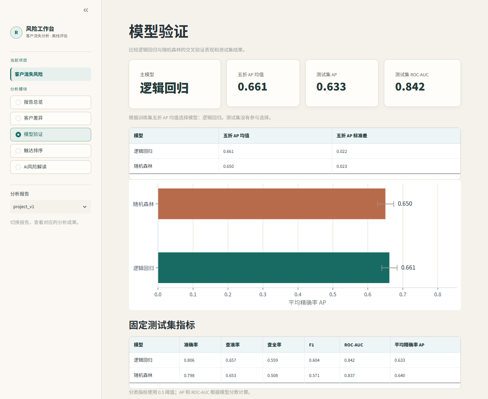
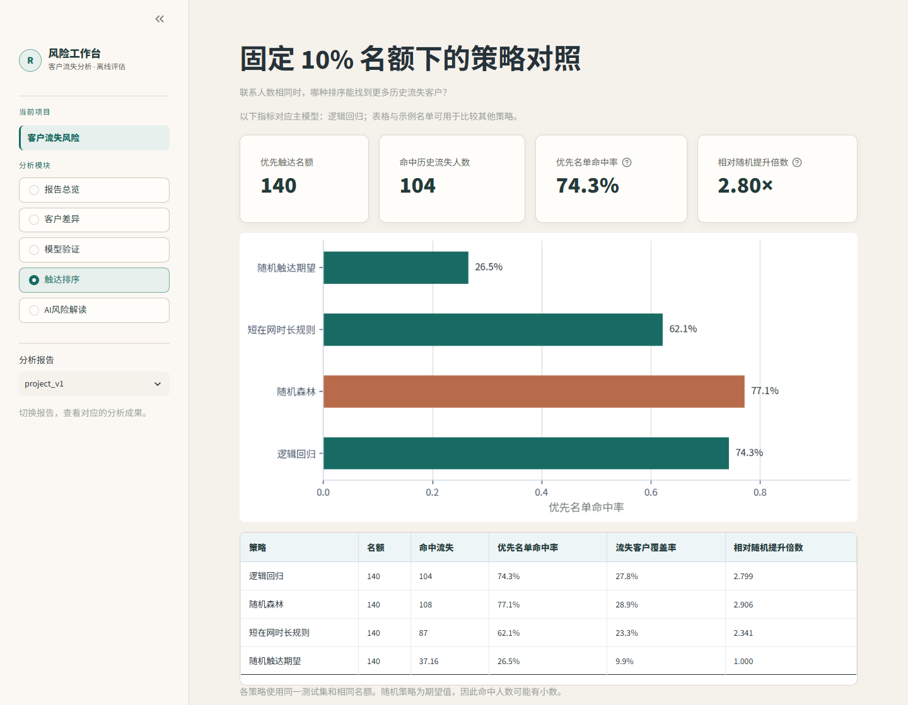
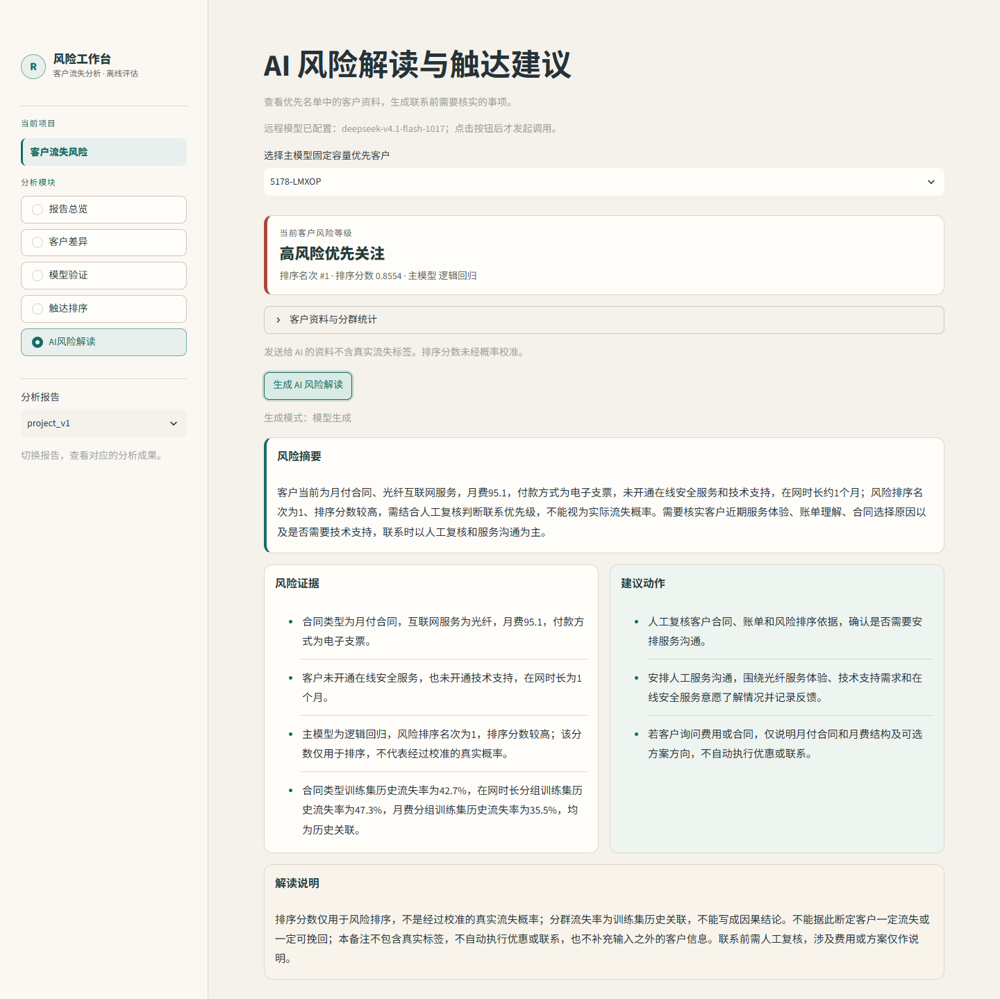
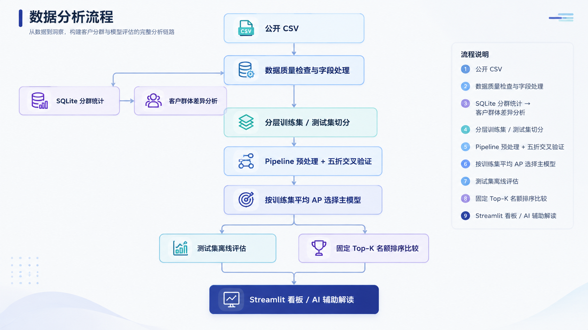

# 电信客户流失分析与用户排序

使用公开的 Telco Customer Churn 数据，分析哪些客户群历史流失率较高，再比较逻辑回归、随机森林和简单规则的客户排序效果。联系名额设为测试集人数的 10%，模型需要在这批名额里找到尽可能多的历史流失客户。

项目使用 Python、SQLite 和 scikit-learn，结果通过 Streamlit 展示。AI 根据入选客户的资料生成联系建议。

## 实验结果

演示报告保存在 `outputs/project_v1/`。数据共 7,043 名客户，按流失标签分层划分为 5,634 条训练样本和 1,409 条测试样本，随机种子为 `42`。

### 模型比较

| 模型 | 五折 AP 均值 | 折间标准差 | 测试集 AP | 测试集 ROC-AUC | 测试集 F1 |
| :--- | ---: | ---: | ---: | ---: | ---: |
| **逻辑回归** | **0.6614** | 0.0218 | 0.6334 | 0.8419 | 0.6040 |
| 随机森林 | 0.6504 | 0.0230 | 0.6399 | 0.8374 | 0.5714 |

主模型选择逻辑回归，因为它的训练集五折 AP 均值更高。随机森林在测试集上略好，也不据此更换主模型。表中的标准差是折间波动，不是置信区间；F1 使用固定分类阈值 `0.5`。

### 联系名额相同时的排序表现

测试集有 374 名历史流失客户，10% 的联系容量向下取整后为 140 人。

| 排序方式 | 命中历史流失人数 | Precision@140 | Recall@140 | Lift@140 |
| :--- | ---: | ---: | ---: | ---: |
| 逻辑回归 | 104 | 74.29% | 27.81% | 2.80 |
| 随机森林 | 108 | 77.14% | 28.88% | 2.91 |
| 短在网时长规则 | 87 | 62.14% | 23.26% | 2.34 |
| 随机选择的期望 | 37.16 | 26.54% | 9.94% | 1.00 |

逻辑回归的前 140 人中有 104 人历史标签为流失，比短在网时长规则多识别 17 人，名单命中率为随机期望的 2.80 倍。这些是历史标签上的离线结果，不能当作实际挽留成功率。

## 看板截图

看板默认打开“报告总览”。其余四页分别查看分群、模型评估、客户排序和 AI 解读，侧栏可切换报告。

### 报告总览



首页展示当前主模型、客户规模、测试集 AP 和优先名单的命中情况。

### 客户差异



训练集中，月付、一年和两年合同客户的历史流失率分别为 42.7%、11.1% 和 2.9%。可以继续切换在网时长、月费分组，查看各组人数及流失比例。

### 模型验证



先比较训练集五折 AP，再查看固定测试集指标。页面下方还有混淆矩阵、ROC 曲线和随机森林特征重要性。

### 触达排序



各策略使用相同的 140 人名额。表格可查看命中率、覆盖率和提升倍数，下方可选择策略查看入选客户。

### AI 风险解读



截图为实际远程接口调用结果，页面标记为“模型生成”。AI 根据客户资料、排序结果和训练集分群统计，给出风险摘要及联系建议；真实流失标签不发送给 AI。

## 运行项目

以下命令均在项目根目录执行。需要 Python 3.10 或更新版本。

### 先查看演示报告

安装依赖：

```bash
python -m pip install -r requirements.txt
```

启动看板：

```bash
python -m streamlit run dashboard.py
```

仓库带有完整的演示报告，不下载原始数据也能打开看板。默认选中最近生成的完整报告，也可以在侧栏切换。

固定查看某份报告：

```bash
python -m streamlit run dashboard.py -- --output outputs/project_v1
```

### 用原始数据重新运行

从 [Kaggle Telco Customer Churn](https://www.kaggle.com/datasets/blastchar/telco-customer-churn) 下载 `WA_Fn-UseC_-Telco-Customer-Churn.csv`，放入 `data/`。

```bash
python run_project.py --output outputs/run_02
```

默认测试集占比为 `0.2`，随机种子为 `42`。如需调整，使用 `--test-size` 和 `--random-state`。原始字段中，`customerID` 须非空且唯一，`Churn` 须包含 `Yes` 和 `No`。

输出目录必须位于项目内，且不存在或为空。`outputs/project_v1/` 已有演示结果，重跑时请指定新目录；若 `outputs/run_02/` 也已使用，就换一个名字。新报告生成后，在看板侧栏选中即可。

### 在 PyCharm 中运行

打开项目并选择已安装依赖的 Python 解释器。训练时运行 `run_project.py`，在运行参数中填写 `--output outputs/run_02`，工作目录设为项目根目录。看板在 PyCharm 的 Terminal 中执行上面的 Streamlit 启动命令。

## AI 接口配置

不配置接口时，按钮会生成模板解读。远程模式使用兼容 Chat Completions 的接口，无需安装本地模型。

将 `.env.example` 复制为 `.env`，填写：

```dotenv
CHURN_AI_BASE_URL=https://your-compatible-endpoint/v1
CHURN_AI_MODEL=your-model-name
CHURN_AI_API_KEY=your-api-key
CHURN_AI_TIMEOUT_SECONDS=20
```

重启看板后进入“AI风险解读”，选择客户并点击“生成 AI 风险解读”。系统环境变量优先于 `.env` 和云端 Secrets。密钥不要提交到仓库。

解读结果和客户选择保留在当前浏览器会话中，切换页面后可以继续查看，不会重复调用接口。不同报告和客户的结果分开保存；客户资料变化后需重新生成。再次点击生成按钮会更新结果。刷新浏览器、关闭标签页或重启服务后，会话记录会清空。

| 页面状态 | 含义 |
| :--- | :--- |
| 模型生成 | 本次远程调用成功 |
| 离线模板模式 | 未配置远程接口，使用固定模板 |
| 远程接口不可用，已回退模板 | 调用或返回内容解析失败，改用模板 |

AI 只读取 `AI_ALLOWED_FIELDS` 中的字段，不包含测试集真实标签，也不修改模型分数或客户名单。建议需要人工确认后再使用。

## 部署到 Streamlit Community Cloud

主文件选 `dashboard.py`。云端直接读取报告，不运行训练。

随代码上传 `requirements.txt`、`.streamlit/config.toml`、`chart_font.py`、`assets/fonts/` 和完整的 `outputs/project_v1/`。中文图表使用仓库自带字体，不依赖云端系统字体。README 中的图片保存在 `docs/`，也要一起提交。

新生成的运行目录默认被 `.gitignore` 忽略。如果要展示自己的报告，须先将同一次运行的完整目录加入版本控制。

### 云端 AI

本机 `.env` 不会上传，需要在应用管理页的 **Settings → Secrets** 顶层填写：

```toml
CHURN_AI_BASE_URL = "https://your-compatible-endpoint/v1"
CHURN_AI_MODEL = "your-model-name"
CHURN_AI_API_KEY = "your-api-key"
CHURN_AI_TIMEOUT_SECONDS = "20"
```

保存并重启应用后，进入 AI 页确认配置状态，再点击生成按钮。调用失败时检查地址、模型名称、密钥和服务是否允许云端访问。

### 旧报告兼容

完整的客户资料保存在 `ai_customer_context.csv`。缺少这个文件时，看板仍可根据同一报告已有的排名、分数和在网时长生成解读，页面会说明资料不全。不会从其他报告拼接客户特征，也不会补造缺失的合同、月费等信息。

## 分析方法



原始数据经过字段检查后按标签分层切分。SQLite 分群统计只使用训练集；缺失值填补、标准化和独热编码放在 scikit-learn Pipeline 内，随每个训练折拟合。候选模型为逻辑回归与随机森林，以训练集五折平均 AP 选出主模型。

模型确定后，在固定测试集上计算分类与排序指标。各策略按分数降序选择前 K 人，同分时按客户编号排序。短在网时长规则优先选在网时间短的客户，随机策略使用数学期望，因此期望命中人数可以是小数。

随机森林特征重要性只能说明该模型使用了哪些特征，不能直接解释逻辑回归。

### 指标定义

| 指标 | 计算与范围 |
| :--- | :--- |
| 客户总量 | 训练集与测试集客户数之和 |
| 历史流失率 | 历史流失人数 ÷ 样本人数；分群页仅统计训练集 |
| AP | 不同阈值下精确率的加权平均，权重为召回率增量；首页展示主模型测试集 AP |
| ROC-AUC | 流失客户得分高于未流失客户的区分能力，平分按一半计入 |
| 查准率 / 查全率 | 预测流失客户中的命中比例 / 全部历史流失客户被识别的比例 |
| F1 | 查准率与查全率的调和平均数，分类阈值固定为 `0.5` |
| Precision@K | 前 K 名中历史流失人数 ÷ K |
| Recall@K | 前 K 名中历史流失人数 ÷ 测试集全部历史流失人数 |
| Lift@K | Precision@K ÷ 测试集整体流失率 |

K 为测试集人数的 `10%` 向下取整。排序按分数取前 K 人，与分类阈值 `0.5` 无关。

## 文件说明

| 文件 | 用途 |
| :--- | :--- |
| `run_project.py` | 训练入口和命令行参数 |
| `churn_pipeline.py` | 数据检查、预处理、模型训练和报告导出 |
| `sql/segment_analysis.sql` | 训练集分群统计 |
| `dashboard.py` | 读取报告并展示看板 |
| `ai_assistant.py` | 筛选 AI 输入、调用远程模型、生成模板解读 |
| `chart_font.py`、`assets/fonts/` | 中文图表字体 |
| `tests/test_project.py` | 数据处理、模型流程、AI 接口和页面测试 |

每次运行的报告存放在 `--output` 指定的目录中：

| 输出文件 | 内容 |
| :--- | :--- |
| `metrics.json` | 样本数、运行配置、交叉验证与模型指标 |
| `overall_summary.csv` | 训练集客户数、流失人数和流失率 |
| `segment_summary.csv` | 分群统计和小样本标记 |
| `policy_metrics.csv` | 各排序策略的命中与覆盖情况 |
| `policy_assignments.csv` | 入选客户、真实标签、名次和排序分数，仅用于离线核验 |
| `ai_customer_context.csv` | 主模型入选客户资料，不含真实流失标签 |
| `predictions.csv` | 测试集标签、模型分数及分类结果 |
| `confusion_matrices.png`、`roc_curve.png` | 分类评估图 |
| `feature_importance.csv` | 随机森林特征重要性 |

## 测试

```bash
python -m pytest tests -q
```

## 数据限制

数据是历史客户快照，缺少事件时间、未来观察窗口和实际干预记录，所以当前任务是识别历史流失标签，不能验证未来预测或挽留收益。分群差异是关联，不能据此断定流失原因。

公开数据已参与项目开发，固定测试集不是独立盲测。模型分数也没有经过概率校准，不能直接当作真实流失概率。依赖版本变化可能造成复现数值差异。

如果换用带时间戳和联系记录的数据，下一步可以按时间划分样本，并评估联系前后的增量效果；这些实验当前尚未实现。

## 数据与参考

- [Kaggle Telco Customer Churn](https://www.kaggle.com/datasets/blastchar/telco-customer-churn)：数据下载。
- [IBM Telco Customer Churn](https://github.com/IBM/telco-customer-churn-on-icp4d)：同类分析案例。
- [Made With ML](https://github.com/GokuMohandas/Made-With-ML)：实验组织与模型评估参考。
