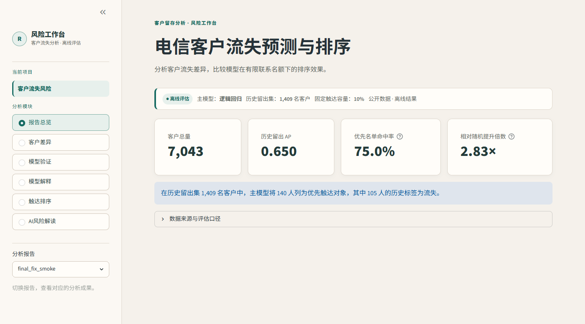
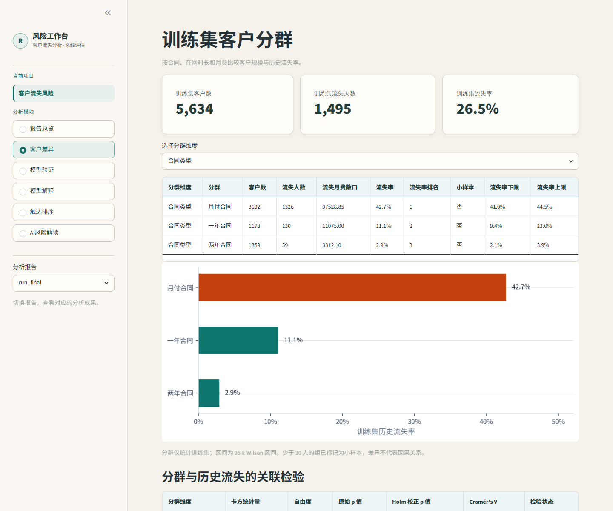
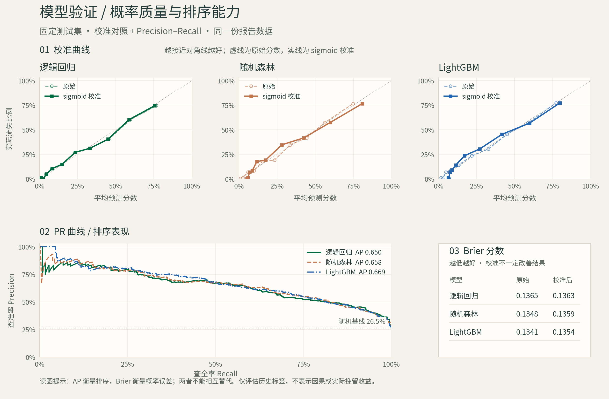

# 电信客户流失预测与排序

基于 **7,043 条公开电信客户记录**，分析不同客户群的历史流失差异，比较逻辑回归、随机森林与 LightGBM，并回答一个具体问题：**联系名额有限时，优先联系哪些客户，能覆盖更多历史流失客户？**

项目包含数据检查、SQL 分群、特征工程、嵌套交叉验证、统计推断、模型解释和固定容量排序，使用 Streamlit 展示分析结果，并提供可选的 AI 客户资料解读。

本次完整实验中，LightGBM 在测试集上的 **AP 为 0.6695**；按分数选出前 **140 人**，其中 **109 人**的历史标签为流失，名单命中率 **77.86%**，为随机选择期望的 **2.93 倍**。这是历史快照上的离线排序结果，不代表实际挽留成功率。

**技术栈：** Python · pandas · SQL（SQLite / MySQL）· scikit-learn · LightGBM · Optuna · SHAP · Streamlit

[看板演示](#看板演示) · [分析流程](#分析流程) · [实验结果](#实验结果) · [运行项目](#运行项目) · [项目结构](#项目结构)

## 看板演示

看板围绕“客户差异—模型验证—触达排序”组织分析，侧栏可切换报告。当前版本包含报告总览、客户差异、模型验证、模型解释、触达排序和 AI 风险解读六个页面。

以下截图均来自当前版本的真实浏览器页面，选择同一份 `run_validated` 报告；没有使用旧版截图或修改截图中的指标。AI 页展示联系前的客户资料界面，未为截图调用远程模型。

### 报告总览



首页集中展示客户规模、主模型、测试集 AP 和优先名单的命中情况，便于先了解结果，再进入具体分析。

### 客户差异



按合同类型、在网时长和月费查看客户规模、历史流失率及 Wilson 区间。分群页同时提供关联检验和合同 × 在网时长交叉统计，区分“比例较高”和“有足够样本支持”的结论。

### 模型验证


比较候选模型的交叉验证表现与固定测试集指标。新版在此基础上加入嵌套验证、相关折修正检验、特征消融、校准前后对照和 PR 曲线；阈值在训练集折外预测中选择，再固定到测试集。

### 触达排序


在相同名额下比较模型、短在网时长规则和随机选择期望，展示命中人数、Precision@K、Recall@K、Lift@K 及入选客户。新版另有训练 OOF 冻结名额和 27 组业务假设情景，与预设 10% 容量对照分开展示。

### AI 风险解读


根据优先客户资料、排序分数和训练集分群统计，生成风险摘要及联系前需要核实的事项。远程接口结果标记为“模型生成”；不配置接口时使用本地模板。**真实流失标签不发送给 AI，AI 不参与模型选择或客户排序。**

### 模型解释


当前版本还可查看逻辑回归系数与描述性 OR 区间，以及树模型的 SHAP 汇总和高分样本解释。页面明确标注解释对象：树模型解释不一定对应主模型，也不包含概率校准映射。

## 分析流程


当前流程在分层切分后，仅用训练集做 SQL 分群和嵌套重复验证；阈值与情景名额在训练 OOF 预测上选择并冻结。实际执行顺序如下：

1. **数据检查与分层切分**：检查客户编号、标签和数值字段，按标签分层留出 20% 测试集。
2. **训练集分群与统计推断**：SQL 汇总合同、在网时长和月费分群，计算 Wilson 区间、卡方检验、Holm 校正和 Cramér's V。
3. **特征工程与内层调参**：构造费用、服务组合和客户阶段等特征；缺失填补、标准化及独热编码随训练折拟合。
4. **外层验证与方法对照**：外层 5 折 × 3 次重复，比较 LR / RF / LightGBM；共享外层划分做 LR 特征消融，并评估校准前后表现。
5. **冻结模型、阈值与名额**：按外层平均 AP 选择模型，训练 OOF 预测用于选择 F1 阈值和业务假设下的名额。
6. **测试集评估与报告展示**：评估固定模型、预设 10% 容量排序及冻结名额情景，导出报告，由 Streamlit 读取展示。

## 实验结果

以下结果来自同一次完整运行：[查看报告元数据](outputs/run_validated/metrics.json)。数据共 **7,043 人**，训练集 **5,634 人**，测试集 **1,409 人**，测试集有 **374 名历史流失客户**，随机种子为 `42`。

外层使用 5 折 × 3 次重复，内层 3 折；LightGBM 每次搜索 30 轮，LR 和 RF 也在内层调参。各模型在当前训练子集内部拟合 sigmoid 校准。测试集不参与本次流程中的调参、模型选择、阈值选择或名额选择。

### 模型比较与折外阈值

| 模型 | 外层 AP 均值 ± 折间标准差 | 测试 AP | 测试 ROC-AUC | 训练 OOF 阈值 | 测试 F1（OOF 阈值） |
|:---|---:|---:|---:|---:|---:|
| 逻辑回归 | 0.6636 ± 0.0188 | 0.6498 | 0.8453 | 0.3383 | 0.6068 |
| 随机森林 | 0.6601 ± 0.0211 | 0.6578 | 0.8464 | 0.3250 | 0.6248 |
| LightGBM | 0.6652 ± 0.0192 | 0.6695 | 0.8482 | 0.3085 | 0.6399 |

主模型按训练集外层平均 AP 选择，本次为 LightGBM。表中标准差是折间波动，不是均值置信区间；分类阈值按训练 OOF 的 F1 选择，不等于业务成本最优阈值，排序也不依赖该分类阈值。

对相关外层得分差异使用 Nadeau–Bengio 近似方差修正，再做 Holm 多重校正。LR–RF、LR–LightGBM、RF–LightGBM 的校正后 p 值分别为 **0.799、0.799、0.623**，均未检出显著差异。因此报告保留均值差异，但不宣称 LightGBM 显著优于其他模型，也不据此认定模型等效。

### 相同联系名额下的排序表现

联系名额固定为测试集人数的 10%，向下取整得到 **140 人**。

| 排序方式 | 命中历史流失人数 | Precision@140 | Recall@140 | Lift@140 |
|:---|---:|---:|---:|---:|
| 逻辑回归 | 105 | 75.00% | 28.07% | 2.83 |
| 随机森林 | 107 | 76.43% | 28.61% | 2.88 |
| LightGBM | 109 | 77.86% | 29.14% | 2.93 |
| 短在网时长规则 | 87 | 62.14% | 23.26% | 2.34 |
| 随机选择的期望 | 37.16 | 26.54% | 9.94% | 1.00 |

LightGBM 在同样的 140 人名额中，比短在网规则多命中 **22 人**，比随机期望多约 **72 人**。所有策略按分数降序、客户编号升序稳定排序；随机行是数学期望，因而允许小数。

### 特征消融

在同一组外层划分下，固定使用逻辑回归家族，比较四组特征；各组分别在内层调参。

| 特征组 | 外层 AP 均值 | 折间标准差 |
|:---|---:|---:|
| 原始特征 | 0.6604 | 0.0172 |
| 原始 + 费用类 | 0.6586 | 0.0171 |
| 原始 + 服务类 | 0.6601 | 0.0167 |
| 全部衍生特征 | 0.6636 | 0.0188 |

全部衍生组比原始组的 AP 均值高约 **0.0031**，但费用类、服务类单独加入没有改善均值。该实验不支持“增加特征就一定提升效果”的说法，也未证明显著改善。逐折结果保存在 [`ablation_folds.csv`](outputs/run_validated/ablation_folds.csv)。

### 概率校准与 PR 曲线



图表使用与看板一致的暖白底色、深色文字和绿／棕／蓝模型配色，校准曲线按模型分面，线型与标记区分原始和校准分数。图片由同次实验的 CSV 重绘，不改变模型预测或统计结果。

| 模型 | 原始测试 Brier | sigmoid 校准后测试 Brier |
|:---|---:|---:|
| 逻辑回归 | 0.1365 | 0.1363 |
| 随机森林 | 0.1348 | 0.1359 |
| LightGBM | 0.1341 | 0.1354 |

Brier 越低越好。本次 sigmoid 校准只让 LR 略有改善，RF 和 LightGBM 反而变差；报告保留预设流程的结果与原始模型对照，没有因查看测试结果而临时更换方案。PR 图中的水平线是测试集整体流失率基线。

### 名额与业务假设情景

除预设 10% 容量对照外，项目还在训练 OOF 预测上选择情景名额，并冻结到测试集。基准假设为触达成本 **50 元/人**、剩余 **12 个月**、成功率 **30%**，每位客户用自己的 `MonthlyCharges` 作为月收入代理。

本次训练 OOF 选择的名额为 **50%**，冻结后测试集的情景净收益约 **52,678 元**。另对 3 档成本、3 档成功率、3 档剩余月份输出 **27 组情景**，名额候选包含不联系和全联系。

这些数值由历史流失标签和业务假设计算，不是实测挽留收入，月费也不等于利润或 CLV。详细口径见 [运行说明](docs/RUNNING.md)。

## 运行项目

以下命令均在仓库根目录执行。使用 Python 3.10，依赖版本见 `requirements.txt`。

### 安装并查看演示报告

```bash
python -m pip install -r requirements.txt
```

```bash
python -m streamlit run dashboard.py
```

已有完整报告时，不需要原始 CSV 或 MySQL 就能查看看板。默认打开最近生成的完整报告，也可在侧栏切换。

固定查看本次新版报告：

```bash
python -m streamlit run dashboard.py -- --output outputs/run_validated
```

### 用原始数据重新训练

从 [Kaggle Telco Customer Churn](https://www.kaggle.com/datasets/blastchar/telco-customer-churn) 下载 `WA_Fn-UseC_-Telco-Customer-Churn.csv`，放入 `data/`。

```bash
python run_project.py --output outputs/run_new
```

默认采用上述完整配置。输出目录必须位于项目内且不存在或为空，**不会覆盖已有报告**；重跑时请使用新的目录名。新报告生成后，在看板侧栏选择即可。

默认使用 SQLite 内存分群，无需配置数据库服务器。希望复核 MySQL 路径时，可配置本机 `.env` 并使用 `--backend mysql`。低预算检查、PyCharm、MySQL、AI 接口和云端部署的详细步骤见 [运行与部署说明](docs/RUNNING.md)。

### 可选 AI 解读

未配置接口时生成本地模板。远程模式读取 `CHURN_AI_BASE_URL`、`CHURN_AI_MODEL`、`CHURN_AI_API_KEY` 和 `CHURN_AI_TIMEOUT_SECONDS`，只有点击生成按钮才发起调用。密钥放在本机 `.env` 或云端 Secrets，不提交到仓库。AI 解读供人工核对，不自动联系客户或改变名单。

## 项目结构

```text
├── README.md                       # 项目介绍、demo、流程与实测结果
├── run_project.py                  # 训练入口
├── dashboard.py                    # Streamlit 看板入口
├── requirements.txt                # 固定直接依赖版本
├── pytest.ini                      # 测试发现和缓存配置
├── telco_churn/
│   ├── pipeline.py                 # 数据检查、特征工程和流程编排
│   ├── validation.py               # 嵌套调参、校准和特征消融
│   ├── reporting.py                # 诊断图与运行溯源
│   ├── statistical_inference.py    # Bootstrap及模型差异检验
│   ├── budget_analysis.py          # 冻结名额与业务假设情景
│   ├── mysql_segments.py           # SQLite / MySQL训练集分群
│   ├── model_explanation.py        # LR描述性系数和树模型SHAP
│   └── test_revision.py            # 核心修复与数据隔离回归测试
├── optional_ai/                    # 可选客户资料解读
├── sql/segment_analysis.sql        # 分群、交叉统计与窗口排名
├── tests/test_project.py           # 流程、接口和看板测试
├── docs/                           # 原有demo截图、流程图及运行文档
├── assets/fonts/                   # 中文字体和许可证
├── data/                           # 原始CSV与下载说明
└── outputs/run_validated/          # 本次完整实验报告
```

### 主要报告产物

| 文件 | 内容 |
|:---|:---|
| `metrics.json` | 运行配置、主模型、测试指标、模型比较、数据哈希和版本信息 |
| `nested_cv_folds.csv` | 每个外层折的 AP、AUC 和校准前后 Brier |
| `ablation_folds.csv` / `ablation_summary.csv` | LR 四组特征逐折结果与汇总 |
| `calibration_comparison.csv` / `calibration_pr.png` | 校准对照及 PR 曲线 |
| `segment_summary.csv` / `segment_inference.csv` | 训练集分群、Wilson 区间、关联检验 |
| `policy_metrics.csv` / `policy_assignments.csv` | 预设 10% 名额策略对照及离线核验名单 |
| `budget_training_oof.csv` / `business_scenarios.csv` | 训练 OOF 名额选择与 27 组情景 |
| `logistic_coefficients.csv` / `shap_summary.png` | 描述性 LR 系数与树模型解释 |

完整字段口径见 [运行说明中的报告文件表](docs/RUNNING.md#报告文件)。

## 测试与复现

```bash
python -m pytest -q
```

指定环境下全套 **47 项测试通过**，包含预处理、模型解释、外层数据隔离、测试标签翻转不影响选择、图表渲染、AI 输入筛选及 Streamlit AppTest。SQLite / MySQL 的总体、分群、交叉分群结果一致，3 份真实报告共 18 个页面的程序渲染检查通过。

GitHub Actions 已配置，远程 CI 尚未运行。新版六页截图已通过本机 Chromium 实际拍摄并目视检查；详细状态见 [实施与验收记录](telco_churn/IMPLEMENTATION_STATUS.md)。

## 数据与方法的适用范围

数据是静态历史快照，缺少统一观察窗口、事件日期和实际干预记录。本项目评估的是历史标签上的区分与排序能力，不能验证未来流失、合同类型的因果影响或实际挽留收益。固定测试集曾用于开发，也不是独立盲测。

校准效果需要用隔离的外层与测试集判断；校准分数对基模型拟合折外，但超参数选择未做第三层隔离。LR 区间固定预处理坐标，仅描述惩罚估计的不确定性；SHAP 解释未校准树基模型，不解释校准映射。由于入组和删失机制不明，当前默认不做生存推断，历史探索产物仍保留。

## 数据与参考

- [Kaggle Telco Customer Churn](https://www.kaggle.com/datasets/blastchar/telco-customer-churn)：数据下载。
- [IBM Telco Customer Churn](https://github.com/IBM/telco-customer-churn-on-icp4d)：同类分析案例。
- [scikit-learn](https://scikit-learn.org/stable/)、[LightGBM](https://lightgbm.readthedocs.io/)、[Optuna](https://optuna.readthedocs.io/)：预处理、建模与调参。
- [SHAP](https://shap.readthedocs.io/)：树模型解释。
